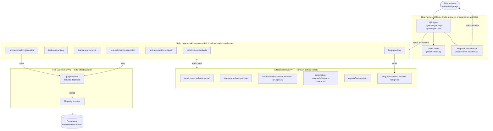
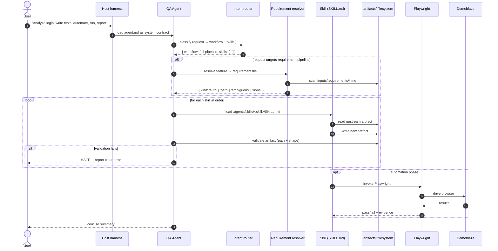
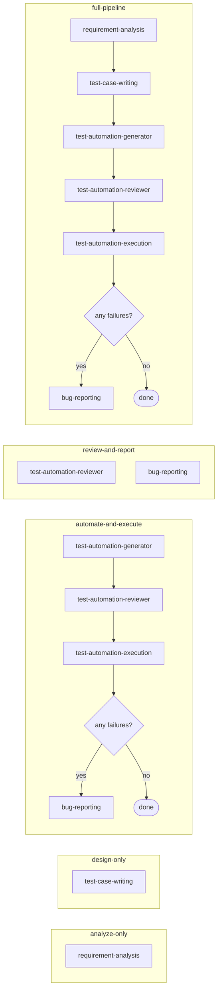
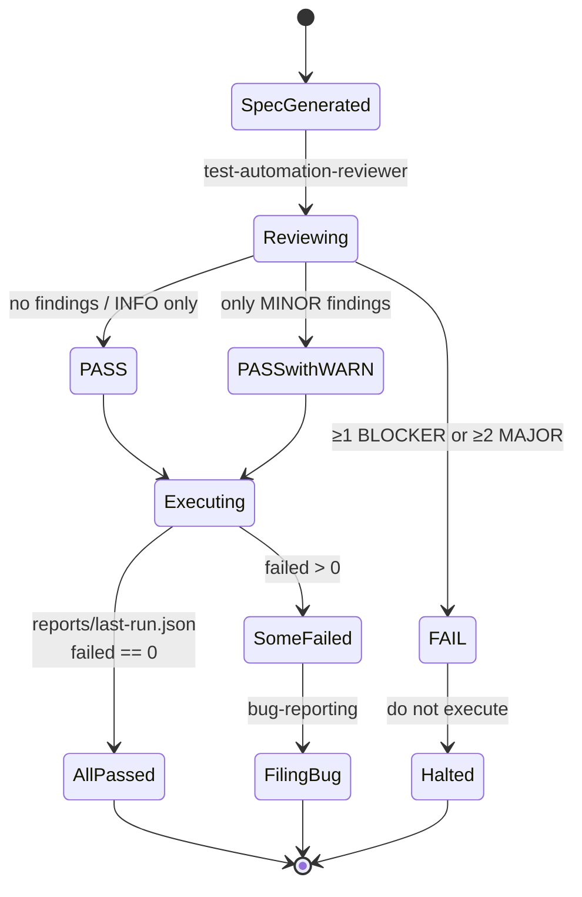
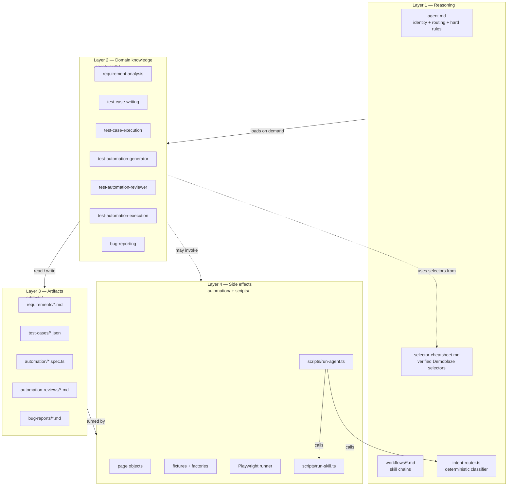
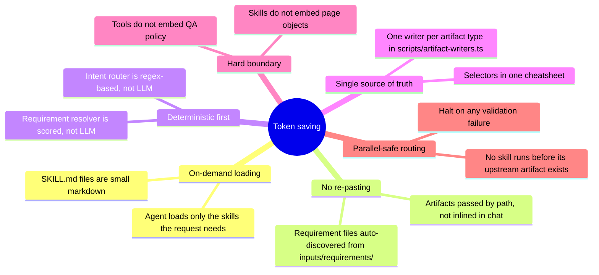
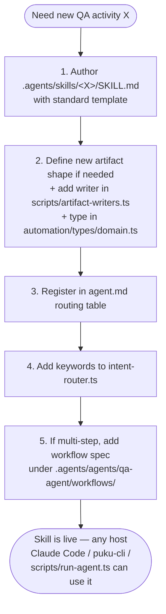

# QA Agent — System Workflow

This document visualizes how the **single QA Agent** routes a natural-language
user request into one or more skills, and how skills exchange artifacts.

The architecture is **token-saving by design**: the agent is a thin
decision-maker, each skill is a small markdown contract loaded only when
needed, and tools (Playwright, file I/O) are never embedded in skills.

---

## 1. High-level architecture



---

## 2. End-to-end request lifecycle



---

## 3. Decision tree: user prompt → workflow

```mermaid
flowchart TD
    P([User prompt]) --> Q1{Contains analyze / requirement /<br/>test cases / automate / script?}
    Q1 -->|No| Q2{Contains review / bug / defect?}
    Q1 -->|Yes| Q3{Multiple skills matched?}

    Q2 -->|Yes| W1[Workflow: review-and-report]
    Q2 -->|No| Q4{Contains run / execute /<br/>smoke / playwright run?}
    Q4 -->|Yes| W2[Workflow: automate-and-execute]
    Q4 -->|No| W3[Workflow: analyze-only<br/>default fallback]

    Q3 -->|No, single match| W4a[analyze-only]
    Q3 -->|Yes, multi-skill| W4[Workflow: full-pipeline]

    W4a -.->|e.g. "Analyze login"| S1
    W1 -.->|e.g. "review this test"| S5
    W1 -.->|e.g. "log a bug"| S7
    W2 -.->|e.g. "run smoke tests"| S6
    W3 -.->|e.g. "design tests for X"| S2
    W4 -.->|e.g. "analyze, write,<br/>automate, run, report"| S1 & S2 & S4 & S5 & S6 & S7
```

---

## 4. The five workflows (skill chains)



---

## 5. Full pipeline — the canonical sequence

```mermaid
flowchart TB
    Start([User: "Analyze login, write tests,<br/>automate, run, report failures"]) --> Pre[Pre-phase:<br/>requirement resolution]

    Pre -->|"auto-discover<br/>or explicit path"| Req[requirement-analysis]
    Req -->|"writes"| A1[("artifacts/requirements/<br/>login.md")]
    A1 -->|validates| V1{file exists +<br/>13 sections +<br/>provenance?}
    V1 -->|no| H1([HALT — clear error])
    V1 -->|yes| TCW[test-case-writing]
    TCW -->|"writes"| A2[("artifacts/test-cases/<br/>login.json")]
    A2 -->|validates| V2{cases[] valid?}
    V2 -->|no| H1
    V2 -->|yes| TAG[test-automation-generator]
    TAG -->|"writes"| A3[("automation/tests/auth/<br/>login.spec.ts")]
    A3 -->|validates| V3{imports baseFixture +<br/>no waitForTimeout?}
    V3 -->|no| H1
    V3 -->|yes| TAR[test-automation-reviewer]
    TAR -->|"writes"| A4[("artifacts/automation-reviews/<br/>login-review.md")]
    A4 -->|validates| V4{verdict?}
    V4 -->|FAIL| H2([HALT — do not run])
    V4 -->|PASS / PASS WITH WARNINGS| TAE[test-automation-execution]
    TAE -->|"runs Playwright"| A5[("reports/last-run.json")]
    A5 -->|any failures?| V5
    V5 -->|no| Done([Done — all passing])
    V5 -->|yes| BR[bug-reporting]
    BR -->|"writes"| A6[("artifacts/bug-reports/<br/>BUG-001-*.md")]
    A6 --> Done
```

---

## 6. Requirement resolution algorithm

This is the pre-step that runs before `requirement-analysis` or
`test-case-writing` to avoid pasting requirement text into chat.

```mermaid
flowchart TD
    R([User prompt]) --> R1[Lowercase + strip stop words]
    R1 --> R2{Contains explicit .md path<br/>(quoted or backticked)?}
    R2 -->|yes| P1[Use cited path verbatim]
    R2 -->|no| R3[Extract feature candidate]
    R3 --> R4[Scan inputs/requirements/*.md]
    R4 --> R5[Score each file:<br/>100 exact slug<br/>80 substring match<br/>60 H1 word match<br/>40 body heading<br/>30 Levenshtein ≤ 2]
    R5 --> R6{Top score unique?}
    R6 -->|yes, score ≥ 30| Auto[Auto-resolve → use file]
    R6 -->|no, all < 30| None[No match — list available,<br/>fall back to free text]
    R6 -->|tie at top| Amb[Ambiguous — ASK user to pick]
    P1 --> Out[Pass to skill as requirementSourcePath]
    Auto --> Out
    None --> Out
    Amb --> Out
```

---

## 7. Skill → artifact → next-skill map

```mermaid
graph LR
    subgraph Inputs["inputs/ (user-authored)"]
        I1[inputs/requirements/login.md]
    end

    subgraph Artifacts["artifacts/ (skill-produced)"]
        O1[requirements/login.md]
        O2[test-cases/login.json]
        O3[automation/tests/auth/login.spec.ts]
        O4[automation-reviews/login-review.md]
        O5[reports/last-run.json]
        O6[bug-reports/BUG-001-*.md]
    end

    I1 -->|requirement-analysis| O1
    O1 -->|test-case-writing| O2
    O2 -->|test-automation-generator| O3
    O3 -->|test-automation-reviewer| O4
    O4 -->|test-automation-execution| O5
    O5 -->|if failures: bug-reporting| O6

    classDef input fill:#fef3c7,stroke:#b45309
    classDef artifact fill:#dbeafe,stroke:#1d4ed8
    class I1 input
    class O1,O2,O3,O4,O5,O6 artifact
```



---

## 8. State machine — review verdict gates execution



---

## 9. Layer responsibilities (what lives where)



**Boundary rule (the token-saving invariant):**
- L2 (skills) does **not** contain selectors, page objects, or fixtures — it speaks in artifact terms.
- L4 (tools) does **not** contain QA policy — it is pure Playwright + file I/O.
- L1 (agent) does **not** bypass L2 contracts — it routes only.

---

## 10. Token-saving properties (why this design scales)



---

## 11. Adding a new skill (migration path)



---

**See also:**

- `.agents/agents/qa-agent/agent.md` — agent contract
- `.agents/skills/<name>/SKILL.md` — per-skill markdown contracts
- `.agents/agents/qa-agent/workflows/*.md` — workflow specs
- `scripts/run-agent.ts` — reference Node host
- `README.md` — full architecture overview
